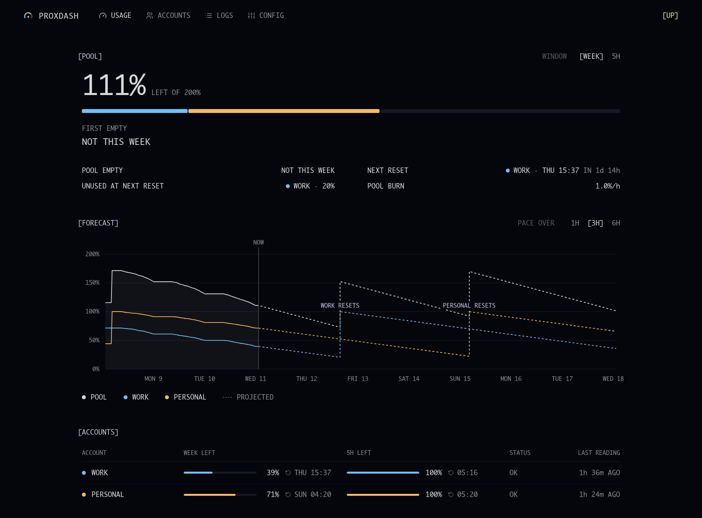

# proxdash

A local dashboard for [CLIProxyAPI](https://github.com/router-for-me/CLIProxyAPI)
when it pools several Claude accounts. It shows how much quota the pool has left,
when it will run out at the current pace, and which project spent it.



## Pages

- **Usage**: what's left of the pool in the weekly or 5-hour window, a forecast
  to the next resets at the recent burn rate, each account's state, and activity
  by project and model.
- **Accounts**: rename, enable or remove accounts, and sign in a new one.
- **Logs**: every request with its project, account, model, tokens, duration
  and status. Requests made by a subagent are marked under the session that started it.
- **Config**: the routing settings in a form, and the raw YAML for the rest.

## How it works

One [Bun](https://bun.sh) service reads the proxy's management API every minute
and stores quota readings and requests in SQLite, kept 30 days. It also serves
the page and forwards its calls, so only the service holds the management key.

The proxy tags each request with Claude Code's session id, which is also the name
of the session's transcript: the transcript's folder gives the project.

proxdash pops the proxy's usage queue, so it must be its only reader: don't
open the usage page of the stock management panel while it runs.

## Run

```sh
bun install
bun run src/server.ts        # http://127.0.0.1:8318
```

It expects CLIProxyAPI on `127.0.0.1:8317` with its management key in
`~/.cli-proxy-api/management-key`. These environment variables override the defaults:

| variable | default |
|---|---|
| `PROXDASH_PORT` | `8318` |
| `PROXDASH_PROXY` | `http://127.0.0.1:8317` |
| `PROXDASH_KEY_FILE` | `~/.cli-proxy-api/management-key` |
| `PROXDASH_DATA` | `~/.local/share/proxdash` |
| `PROXDASH_TRANSCRIPTS` | `~/.claude-hub/projects` |

`PROXDASH_TRANSCRIPTS` is the `projects` folder of the Claude Code config
directory the proxied sessions use (`~/.claude/projects` by default).
